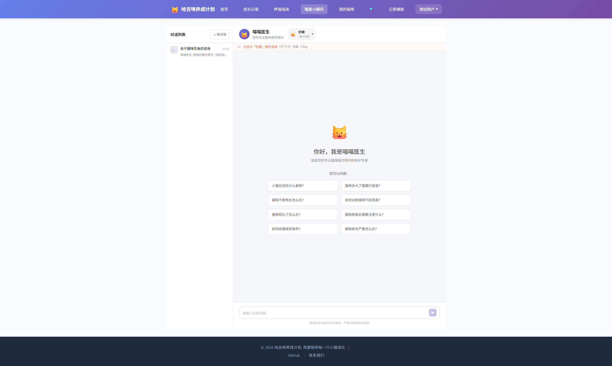
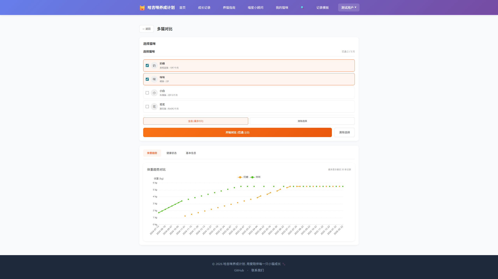

# 🐱 PangHu · 哈吉咪养成计划

> 一只能读懂你家猫真实健康数据的 AI 养猫助手 —— 档案管理 × AI 问诊 × 陪玩推荐

[](LICENSE)


**PangHu** 是一个全栈开源项目：为你的猫建立健康档案，AI 顾问「喵喵医生」在回答问题时会**真实查询**这只猫的体重曲线、疫苗记录、过敏史和养护知识库 —— 而不是泛泛而谈。

<p align="center">
  
  
  
</p>

## ✨ 它能做什么

### 🤖 AI 健康顾问（核心亮点）
- **带工具调用的 Agent**：LLM 通过 14 个工具（查档案 / 体重趋势 / 健康评估 / 疫苗检查 / RAG 知识检索…）读取真实数据后回答，前端实时渲染工具调用卡片
- **智能追问**：说「猫不吃东西」会追问持续了多久，说「呕吐超过 24 小时」则直接给出就医建议——内建问诊流程
- **RAG 知识库**：养护指南入库向量化（2048 维 embedding），回答附引用来源，拒绝凭空编造
- **写入需确认**：让 AI 记体重、登记疫苗时会生成确认卡片，确认后才落库——AI 不碰你的数据

### 📔 猫咪档案与成长记录
- 多猫管理、成长时间线、疫苗提醒、体重趋势与健康比对、成长里程碑
- 养猫小指南、计划模板、健康周报自动生成

### 🎾 陪玩推荐
- 根据猫咪性格、精力基线与用户偏好推荐互动游戏，持续收集反馈优化推荐

## 🏗️ 架构

```
Vue 3 + Element Plus + Pinia (PWA)
        │  SSE 流式
        ▼
Express + Prisma ──► PostgreSQL (Supabase / 自托管)
        │
        ├─► LLM Agent: 意图路由 → 工具调用(14 tools) → 确认门禁
        ├─► RAG: 智谱 embedding-3 向量检索知识库
        └─► 智谱 GLM-4.5-flash (免费额度即可运行)
```

Agent 采用**三层意图路由**：embedding 意图召回快路径（零 LLM 调用）→ LLM tool-calling 循环 → 规则管线兜底，兼顾延迟与可用性。

## 🚀 快速开始

### 方式一：Docker 一键启动（推荐）

```bash
git clone https://github.com/<your-name>/PangHu.git
cd PangHu

# 1. 准备环境变量：填入你的智谱 API Key（https://open.bigmodel.cn 免费申请）
cp .env.docker.example .env
vi .env

# 2. 构建并启动（首次构建约 3-5 分钟）
docker compose up -d --build

# 3. 打开 http://localhost:3000 注册账号即可使用
```

> 首次启动会自动建表；如需演示数据（示例猫、知识库文章），设置 `SEED_ON_START=1`。

### 方式二：本地开发

```bash
# 后端（Node 20+，PostgreSQL 任选本地/Supabase）
cd backend
cp .env.example .env        # 填 DATABASE_URL / JWT_SECRET / ZHIPUAI_API_KEY
npm install
npx prisma db push && npm run db:seed
npm run dev                 # http://localhost:3000

# 前端（另开终端）
cd frontend
npm install
npm run dev                 # http://localhost:5173

# 测试
npm run test:unit           # 根目录：后端单测
npm run test:frontend       # 前端单测
```

## 🔑 关于 AI 费用

项目使用智谱 GLM（`glm-4.5-flash`），**新用户免费额度足以日常使用**；embedding 走同平台。在 [open.bigmodel.cn](https://open.bigmodel.cn) 注册即得。

## 📁 项目结构

```
├── backend/            Express + Prisma + Agent
│   ├── src/agent/      LLM Agent（路由/规划/执行/工具/确认门禁/SSE）
│   ├── src/services/   业务服务层（RAG、健康周报、陪玩推荐…）
│   ├── prisma/         数据模型（21 张表）
│   └── scripts/dev/    本地调试脚本
├── frontend/           Vue 3 + Vite + Element Plus + Pinia (PWA)
├── docs/               产品 / 开发 / 设计 / 复盘文档
└── scripts/mac-mini/   Mac Mini 自托管部署套件（PM2 + launchd）
```

## 🧪 质量基建

- 后端 vitest 单测 + API 测试（agent 工具、确认流、权限边界、RAG）
- 前端 vitest 单测；`tsc` 严格类型检查
- LLM Agent 意图路由回归测试 + prompt 评测脚本（`npm run eval:prompt`）
- featureFlags 灰度开关体系（生产环境安全降级）

## ⚠️ 免责声明

本项目中的 AI 健康建议由大语言模型生成，**仅供养护参考，不能替代专业兽医的诊断与治疗**。若宠物出现紧急症状，请立即联系宠物医院。

## 📚 更多文档

完整文档在 [`docs/`](docs/README.md)：产品 PRD、技术架构、AI Agent 开发指南、部署指南（Vercel / Mac Mini）、复盘记录。

## 📄 License

[MIT](LICENSE) © 2026 yintao & PangHu contributors
